# Brim

**A living notch for your Mac.** Music, your next meeting, timers, notes, system stats, weather and
your AI coding limits, one hover away from the notch at the top of your screen.

Brim is a small, free, open-source Mac app. The closed notch quietly shows what matters right now
(the song playing, a running timer, how close you are to a plan limit). Hover over it, or press
**⌥ Space**, and it opens into tabs.

<p align="center">
  <a href="https://github.com/abhargava14/brim/releases/latest/download/Brim.dmg">
    <picture>
      <source media="(prefers-color-scheme: dark)" srcset="media/readme/download-dark.svg">
      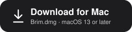
    </picture>
  </a>
</p>
<p align="center"><sub>Always the latest release · Apple silicon and Intel · free and open source ·
<a href="#if-mac-says-brim-cant-be-opened">first open</a> · <a href="https://github.com/abhargava14/brim/releases">all releases</a></sub></p>

Brim used to be called AI Island. Updating moves your connections, saved tokens, settings and
the Claude Code status line over on first launch, and the old `ai-island` command still works.

- **Sixteen tabs, pick your own.** Home, AI, Analytics, Notes, Calendar, Timers, Clocks, Stats,
  Screen Time, Weather, Links, Sounds, Scratchpad, Clipboard, Files and Units.
  Eight show by default; the rest wait under the grid button. Reorder and hide them in Settings.
- **AI usage, still first class.** Claude Code, Codex, GitHub Copilot, Cursor, Windsurf,
  OpenRouter, and anything else that writes logs or reports usage at a URL. As many accounts as
  you like, labelled (personal, work) so you can tell them apart.
- **Private.** No account, no tracking, no money anywhere. Your prompts, code, notes and
  clipboard never leave your Mac.

## About the app

<p align="center">
  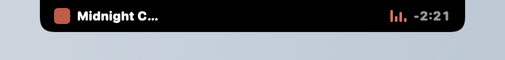
</p>
<p align="center"><em>The closed notch: what's playing, a running timer, or your nearest AI limit.</em></p>

<p align="center">
  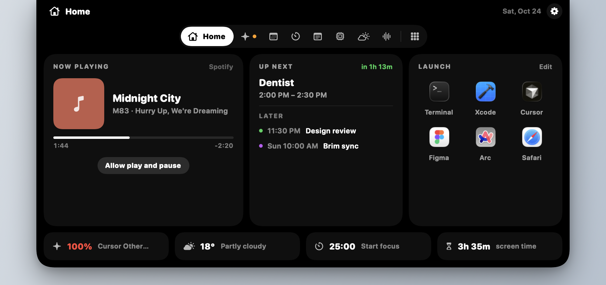
</p>
<p align="center"><em>Home — now playing, your next event, a launcher, and a glance row.</em></p>

<p align="center">
  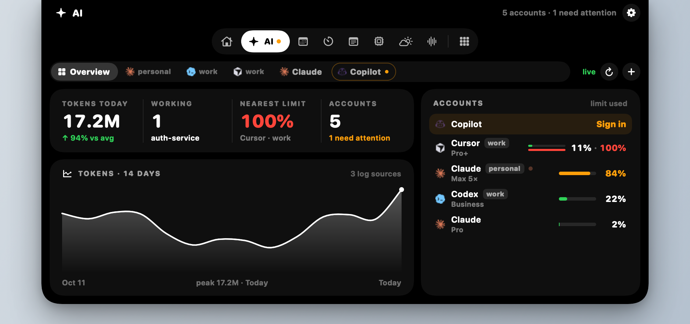
</p>
<p align="center"><em>AI — every account, highest limit first, and half a year of activity with your streak. Broken accounts sort to the top with one fix.</em></p>

<p align="center">
  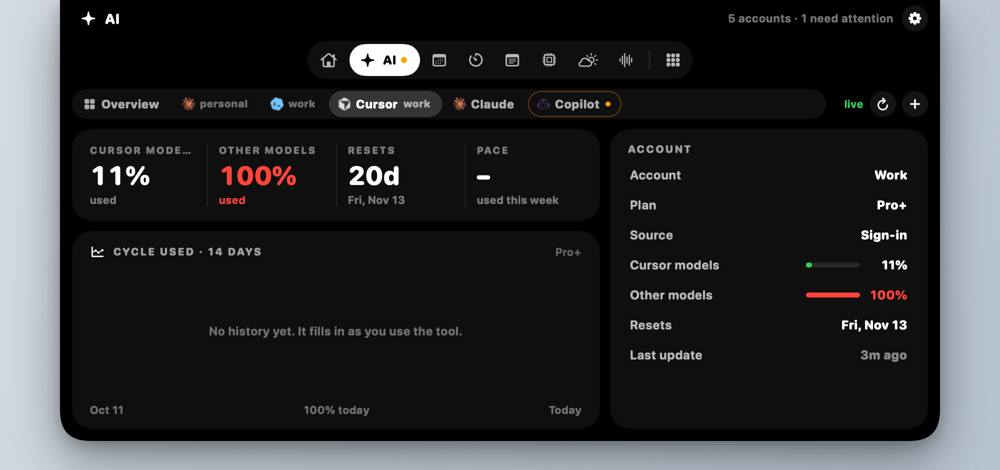
</p>
<p align="center"><em>One account — each plan pool on its own (Cursor models and other models), with the plan and reset date.</em></p>

<table>
<tr>
<td>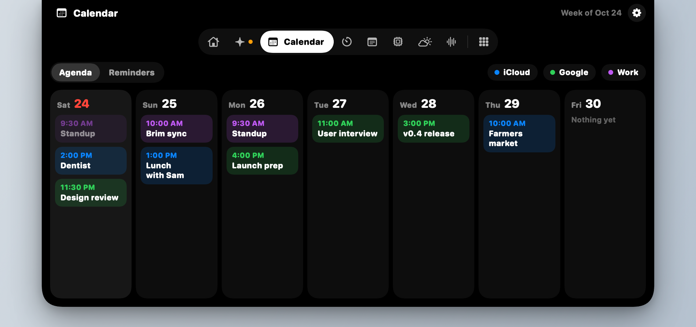</td>
<td>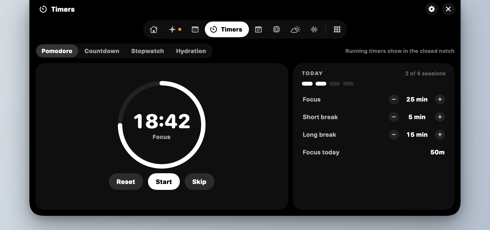</td>
</tr>
<tr>
<td align="center"><em>Calendar</em></td>
<td align="center"><em>Timers</em></td>
</tr>
<tr>
<td>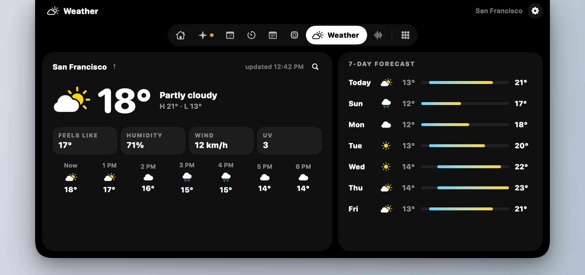</td>
<td>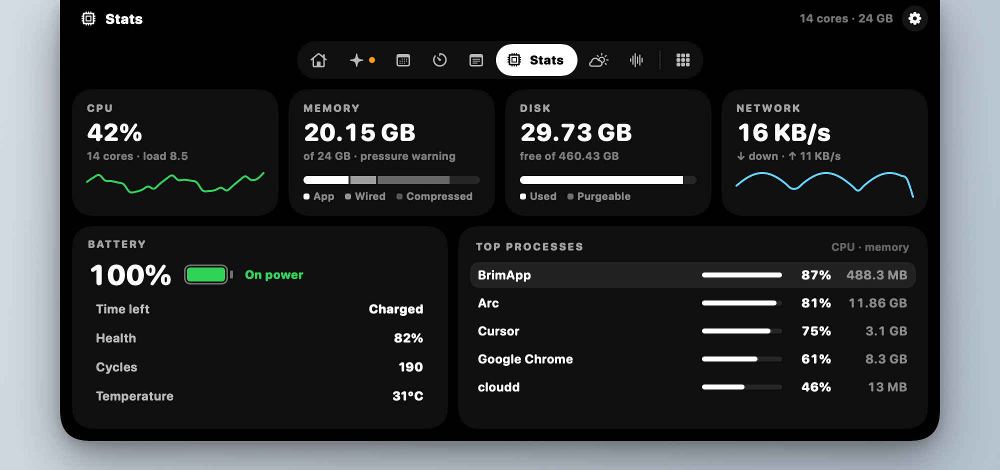</td>
</tr>
<tr>
<td align="center"><em>Weather</em></td>
<td align="center"><em>Stats</em></td>
</tr>
<tr>
<td>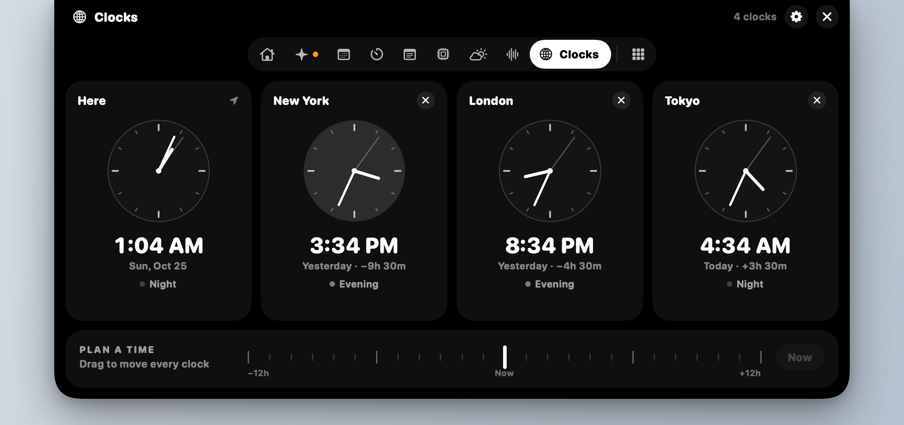</td>
<td>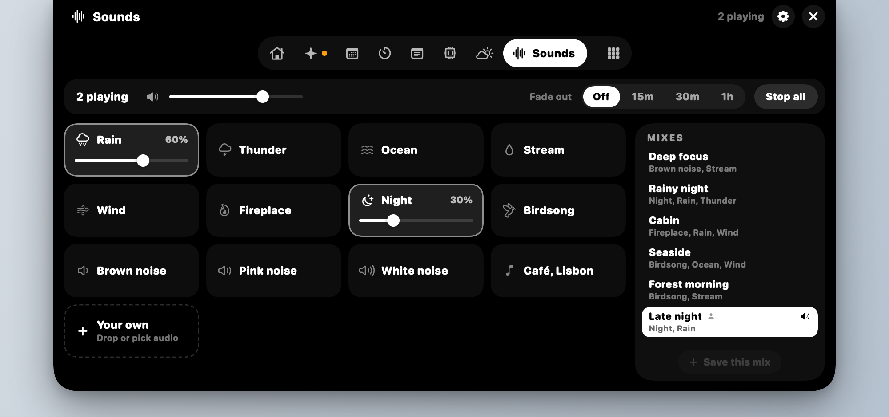</td>
</tr>
<tr>
<td align="center"><em>Clocks</em></td>
<td align="center"><em>Sounds and mixes</em></td>
</tr>
<tr>
<td>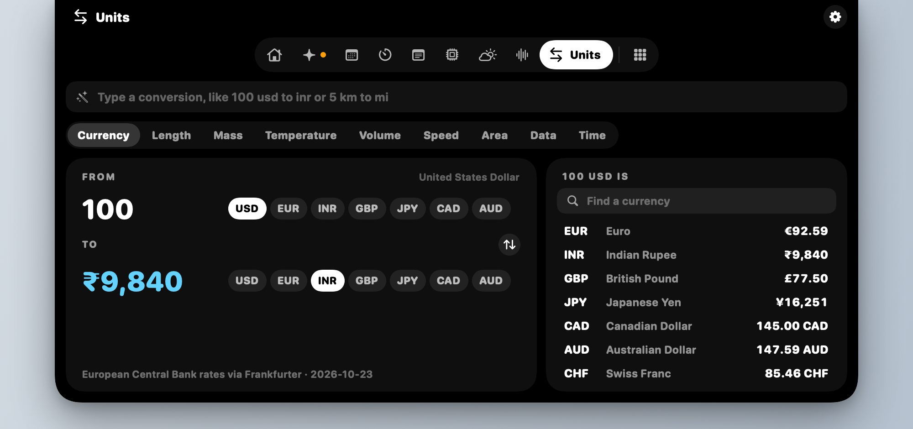</td>
<td>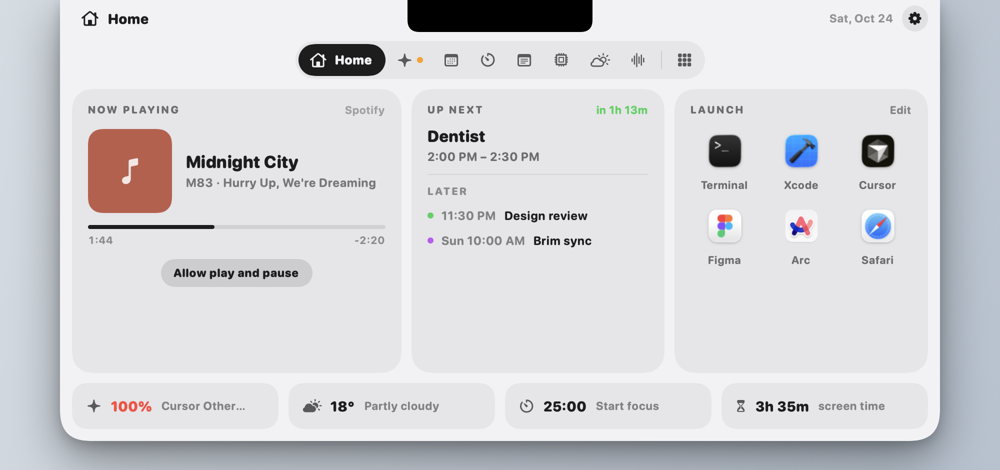</td>
</tr>
<tr>
<td align="center"><em>Units and currency</em></td>
<td align="center"><em>Light theme</em></td>
</tr>
</table>

<p align="center">
  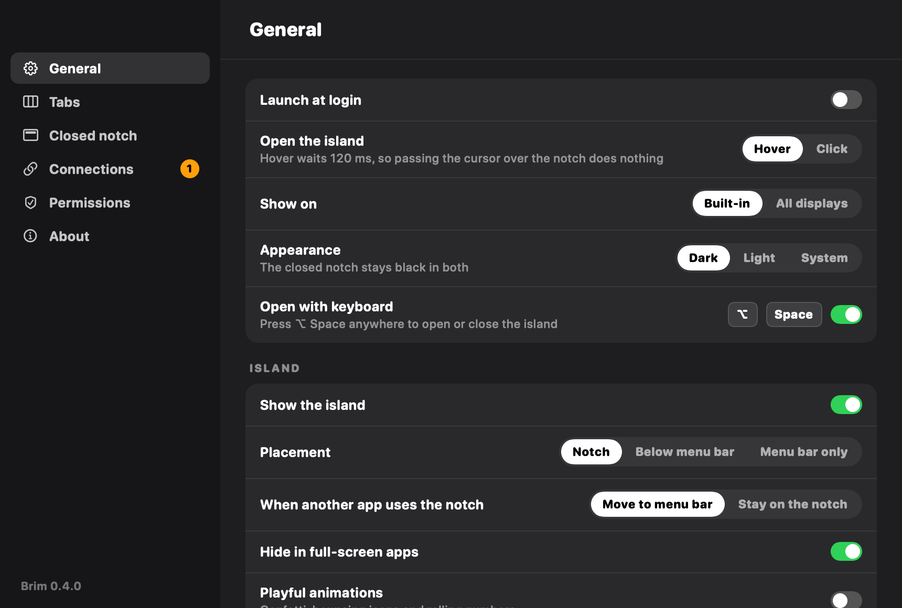
</p>
<p align="center"><em>Settings — tabs, the closed notch, connections and permissions in one window.</em></p>

---

## Contents

- [Requirements](#requirements) · [Mac requirements](docs/mac-requirements.md)
- [Install](#install) · [Quick setup (CLI)](docs/quick-setup-cli.md)
- [Updating](#updating) · [How to update](docs/how-to-update-brim.md)
- [Connect your first tool](#connect-your-first-tool)
- [Using the island](#using-the-island)
- [Supported tools](#supported-tools)
- [Plans and limits](#plans-and-limits)
- [Command reference](#command-reference)
- [Privacy](#privacy)
- [Troubleshooting](#troubleshooting)
- [Uninstall](#uninstall)
- [Contributing](#contributing)

## Requirements

- A Mac on **macOS 13 Ventura or later** (Apple silicon or Intel).
- **You do not need Xcode** (the big App Store app) for normal use.

A MacBook with a notch looks best, but any Mac works. Without a notch, the island hangs from the
top centre of the screen.

What each install path needs: [docs/mac-requirements.md](docs/mac-requirements.md).

## Install

### Easiest — Download the Mac application

**No Xcode. No Terminal. No developer tools.**

1. **[Download Brim.dmg](https://github.com/abhargava14/brim/releases/latest/download/Brim.dmg)**
   (always the latest release; older ones are on the [Releases page](https://github.com/abhargava14/brim/releases)).
2. Open the DMG and drag **Brim** into **Applications**. The DMG window shows the first-open steps too.
3. Open Brim from Applications (see below if macOS shows a warning).
4. Optional: check the download against `Brim.dmg.sha256` from the same release
   (`shasum -a 256 -c Brim.dmg.sha256` in the folder you downloaded both to).

You'll know it's running when you see the Brim mark in the menu bar and a black shape around the notch.

#### If Mac says Brim can’t be opened

macOS may show **“Brim Not Opened — Apple could not verify…”** (or similar). That’s **normal** until
the app is Apple-notarized — **not malware**. On **Sonoma / Sequoia** the dialog often only has
**Done** / **Move to Bin** (no **Open**); right‑click → **Open** usually fails.

**Workaround (once is enough) — current macOS:**

1. Drag **Brim** into **Applications** (don’t run it only from the DMG).
2. Double‑click Brim once; if the dialog appears, click **Done** (not **Move to Bin**).
3. **System Settings → Privacy & Security** → scroll to **“Brim was blocked…”** → **Open Anyway**.
4. Confirm again if macOS asks (password / **Open Anyway** a second time).

**Optional Terminal** (clears quarantine on that app only — does not disable Gatekeeper):
`xattr -cr /Applications/Brim.app`, then open Brim again.

**Older macOS only:** right‑click (Control‑click) Brim in Applications → **Open** → **Open**.

Do **not** turn Gatekeeper off system‑wide. Friend-facing steps:
[docs/gatekeeper-friend-install.md](docs/gatekeeper-friend-install.md). Permanent fix (Developer ID +
notarize): [docs/notarization.md](docs/notarization.md).

#### Passwords and approvals

Brim asks for things **once**, and updates keep them:

- **Keychain:** only when you sign in to an account (Claude, Cursor…). Pick **Always Allow**.
  Background refreshes never show a password sheet.
- **Calendar, Location, Notifications, Automation:** only when you use the tab that needs it.

Every Brim build has the same code identity (its bundle ID), so macOS keeps treating an updated
Brim as the same app. Updating from 0.3.x asks once more, because those builds didn't have that
identity yet. The one step that stays until Brim is signed with an Apple Developer ID is the
first-open Gatekeeper warning above. Installing from Terminal skips it, because builds made on
your own Mac aren't marked as downloaded.

### Later updates (still no Xcode)

- In the app: menu bar ✳ → **Check for Updates…**
- Or, if you use Terminal: `brim update`

### For developers / Terminal (optional)

These paths **compile Brim on your Mac**. They need Apple's small **Command Line Tools** package
(`xcode-select --install`) — **not** the full Xcode app from the App Store.

`install.sh` today **builds from source** (it does not download a prebuilt DMG). Details:
[docs/quick-setup-cli.md](docs/quick-setup-cli.md).

**Pinned install script** (pins a release; about a minute the first time):

```bash
curl -fsSL https://raw.githubusercontent.com/abhargava14/brim/v0.5.2/install.sh -o install-brim.sh
chmod +x install-brim.sh
./install-brim.sh
```

**From a clone:**

```bash
git clone https://github.com/abhargava14/brim.git
cd brim
git checkout v0.5.2
./scripts/build-app.sh --install
```

Terminal installs build on your Mac, so there is no Gatekeeper warning to click through.

**Homebrew** (tracks `main`, also builds from source):

```bash
brew install --HEAD abhargava14/tap/brim
```

**Build a DMG yourself** (also needs Command Line Tools): see `./scripts/build-dmg.sh` and
[docs/notarization.md](docs/notarization.md).

## Updating

Quit alone does **not** fetch new builds. Prefer:

1. Menu bar ✳ → **Check for Updates…** (no Xcode), or
2. `brim update` (`--check` only reports), or
3. Reinstall from a newer **Brim.dmg**, or rebuild via Terminal.

More detail: [docs/how-to-update-brim.md](docs/how-to-update-brim.md).

## Connect your first tool

On first launch, Brim adds **Claude Code** and **Codex**. If you use either, you'll see your
usage within a few seconds. To add more, use whichever way you prefer. Both change the same
list, so you can mix them.

### In the app

1. Click the ✳ icon in the menu bar and choose **Connections & Settings**. (Or hover over the
   island and click ⚙.)
2. Click **Add connection** and pick a tool.
3. If the tool needs a token, paste it into the box that appears and click **Save**.
4. Use the switch next to each connection to turn it on or off. **Disconnect all** turns
   everything off.

### In the terminal

```bash
brim add claude          # Claude Code
brim add codex           # Codex CLI
brim add copilot         # GitHub Copilot
brim add cursor          # Cursor
brim add openrouter      # OpenRouter (asks for your API key)

brim status              # see your usage
```

Each `add` checks the connection straight away and tells you whether it worked, and what to do if
it didn't.

**Two accounts of the same tool?** Add it twice and give each a name:

```bash
brim add claude --name "Claude · Work" --path ~/work/.claude/projects
```

## Using the island

| You do | What happens |
|---|---|
| Glance at the notch | It rotates between the song playing and your AI limits, plus your next event, the weather or a clock if you turn them on. A running timer or a pinned scratchpad takes over |
| Hover over the notch, or press ⌥ Space | It opens to the tab you used last. Click a tab to switch; the grid button lists every tab |
| Click into a text field (notes, links, reminders) | The island stays open while you type. Esc or a click elsewhere closes it |
| Drag images onto the notch | It opens Files with them queued to convert |
| Click the gear | Settings: General, Tabs, Closed notch, Connections, Permissions and About |

**The tabs**

| Tab | What it does | Needs |
|---|---|---|
| Home | Now playing, up next with a Join button, a launcher, and a glance row | Calendar access (optional) |
| AI | Overview plus one pill per account: limits, tokens, a 14-day chart or a half-year activity heatmap with your streak, what broke and the fix | Local logs or sign-in |
| Analytics | Visitors, pages and sources for your sites | A key from DataFast, Plausible, Umami (Cloud or self-hosted) or Fathom, or a Google service account |
| Notes, Scratchpad | Longer notes with search and pins; one always-there text box you can pin to the closed notch | Nothing |
| Calendar | Day, week and month views with a legend of your calendars (tap one to hide it), and reminders you can tick off or add with Return | Calendars and Reminders access |
| Timers | Pomodoro, countdown, stopwatch and hydration reminders | Notifications (optional) |
| Clocks | Your time and up to three cities, each with its offset and whether people there are working; drag the planner to see them all at another time | Nothing |
| Stats | CPU, memory, disk, network, battery health and the busiest apps | Nothing |
| Screen Time | Where the day went, app by app, counted by Brim from the day you turn it on | Nothing |
| Weather | Now, an hour-by-hour chart for any of the next seven days, air quality, wind and sun times, for your location and saved cities, from Open-Meteo | Location, or a city you pick |
| Links | Search with Google, DuckDuckGo, Perplexity, ChatGPT, Claude, YouTube and more (or your own engine and keyword, like `yt cats`), plus your saved sites in folders | Nothing |
| Sounds | Rain, thunder, ocean, stream, wind, fireplace, night, birdsong and noise, layered, plus your own recorded loops; built-in and saved mixes; a fade-out timer | Nothing |
| Files | Convert and shrink images to JPEG, PNG, HEIC or PDF, then drag the results out | Nothing |
| Clipboard | A searchable history of what you copy, filtered by kind, with pins and app icons. Off until you turn it on; skips password managers and any app you ignore | Nothing |
| Units | Units and currencies: "5 km to mi", "100 usd to inr". Exchange rates from the European Central Bank via Frankfurter, refreshed daily | Nothing |

**The closed notch interrupts once when something happens:** a plan passed 80% or 95%, an account
signed out, a timer finished, or (if you turn it on) a meeting is five minutes away. Each can be
switched off in **Settings → Closed notch**.

Animations respect **Reduce Motion**. The island lets clicks through to the menu bar around it,
never covers menus or status icons, and hides when an app is full screen. The open island follows
**Settings → General → Appearance** (dark, light or system); the closed notch is always black.

## Supported tools

| Tool | What you need | What you'll see |
|---|---|---|
| **Claude Code** | Nothing. Brim reads its local logs. | Tokens, sessions, 5-hour and weekly limits* |
| **Codex CLI** | Nothing. Brim reads its local logs. | Tokens, sessions, 5-hour and weekly limits |
| **GitHub Copilot** ⚠︎ | The [GitHub CLI](https://cli.github.com) signed in (`gh auth login`), or a GitHub token | Your plan and premium requests used, e.g. 212 / 300 |
| **Cursor** ⚠︎ | The Cursor app signed in on this Mac | Your plan and included usage % |
| **Windsurf** ⚠︎ | The Windsurf app signed in on this Mac | Your plan and credits used % |
| **OpenRouter** | An [API key](https://openrouter.ai/keys) | Credits used against the key's limit |
| **Log folder** | A folder of Claude Code- or Codex-style `.jsonl` logs | Tokens and sessions |
| **Usage URL** | Any web address that returns your usage as JSON | Your usage as a % of your limit |

\* Claude Code only shares plan limits with one extra step. Run `brim claude-limits connect`,
or use **Settings → Plan usage → Connect**. It adds a tiny status-line script to Claude Code and
keeps any status line you already have.

⚠︎ **Experimental.** Copilot, Cursor and Windsurf don't offer a public way to read usage, so
Brim uses the same private connection their own apps use. If one of them changes it, that
connection shows a message and everything else keeps working.

<details>
<summary><b>Connecting a Usage URL (for any other tool)</b></summary>

If a service shows your usage at a URL that returns JSON, Brim can read it. Tell it where the
numbers are with "dot paths":

```json
{ "data": { "used": 420, "limit": 1000, "plan": "Team" } }
```

```bash
brim add custom --name "Acme AI" \
  --url https://api.acme.dev/v1/usage \
  --used data.used --limit data.limit --plan-path data.plan \
  --token-stdin                     # then paste the token and press Enter
```

The token is sent as `Authorization: Bearer <token>` by default. Change it with
`--header` and `--prefix`.
</details>

## Plans and limits

Every connection has a plan, such as Claude **Max 5×**, Copilot **Pro+** or Cursor **Ultra**.
Choose it in Settings or with `brim plan <name> <plan>`, or leave it on **Automatic**.

The plan decides what the island shows first:

- **Subscriptions and monthly allowances** (Claude Pro/Max, ChatGPT Plus/Pro, Copilot, Cursor,
  Windsurf): how much of the limit you've used, as a %.
- **Pay-as-you-go API keys:** tokens used today.

Limits and percentages always come from the tool itself. Brim never guesses them.

## Command reference

| Command | What it does |
|---|---|
| `brim status` | Usage for everything connected. Add `--json` for scripts. |
| `brim list` | Every connection, and whether it's on or off |
| `brim kinds` | Tools you can add, and their plan names |
| `brim add <tool> [options]` | Add and connect a tool |
| `brim connect <name>` / `--all` | Turn a connection back on, or all of them |
| `brim disconnect <name>` / `--all` | Turn a connection off (keeps its settings) |
| `brim remove <name>` | Delete a connection and its saved token |
| `brim set <name> [options]` | Change a connection's name, folder, URL… |
| `brim plan <name> <plan>` | Set a connection's plan (`auto` to go back) |
| `brim claude-limits connect` | Share Claude Code's 5-hour and weekly limits |
| `brim open` | Open the app |
| `brim update` | Check GitHub Releases and install if newer (`--check` to only report) |
| `brim help` | All options, with examples |

Common options: `--name`, `--plan`, `--path` (log folder), `--token-stdin` (paste a token
safely).

## Privacy

- **No account, no analytics, no tracking.** Brim asks for a macOS permission only when you use
  the tab that needs it, and Settings → Permissions shows what's allowed.
- **Stays on your Mac:** notes, scratchpad, links, timers, screen time (app names and minutes
  only, never window titles), and pinned clipboard items live in
  `~/Library/Application Support/Brim/`. Clipboard history is off until you turn it on, is kept
  in memory only unless you switch on **Keep after quitting**, and skips anything password
  managers mark as concealed or transient, plus anything copied in an app you ignore.
- **Calendar and reminders** are read through macOS (EventKit). Brim never sees your Google or
  Exchange passwords.
- **Music:** song names come from Spotify's and Music's own notifications. Play, pause, skip and
  artwork use Automation, which you turn on yourself.
- **Your prompts, replies and code are never read.** For Claude Code and Codex, Brim reads
  only usage numbers from their logs: tokens, model, time, session and project folder name.
- **Tokens are stored in your Mac's Keychain**, never in plain files. When Claude's OAuth
  access token is refreshed, Brim updates Claude Code's own Keychain item (same service name)
  in-process so the secret never appears on process argv.
- **Cursor / Windsurf:** connecting without a pasted token reuses that editor's local session
  from `state.vscdb` (allowlisted keys only), then copies it into Brim's Keychain so the DB
  is not re-read every refresh.
- **Network:** log-based tools never touch the network. Built-in account tools only call an
  allowlisted HTTPS host for that tool. **Check for Updates** / `brim update` only contact
  `api.github.com` / `github.com` for `abhargava14/brim` Releases (and download the release
  asset). Custom Usage URLs must be `https://` (no cleartext `http://`). Brim trusts macOS
  system roots (no certificate pinning — see security notes in the engineering review
  deliverable).
  The tabs add: **Open-Meteo** (`api.open-meteo.com`, `geocoding-api.open-meteo.com`,
  `air-quality-api.open-meteo.com`) for weather, with your coordinates rounded to about 100 m;
  **Frankfurter** (`api.frankfurter.dev`) for exchange rates; for sites you add to Analytics only,
  **DataFast** (`datafa.st`), **Google** (`oauth2.googleapis.com`, `analyticsdata.googleapis.com`),
  **Plausible** (`plausible.io` or your own server), **Umami** (`api.umami.is` or your own
  server) or **Fathom** (`api.usefathom.com`); Spotify's artwork server for the album cover; and
  links you open yourself.
- Your connection list lives in `~/Library/Application Support/Brim/connections.json`
  (mode `600`). It holds no secrets.
- Custom log folders must resolve under your home directory; symlink escapes are refused.

## Troubleshooting

**macOS says the app "can't be opened" / “Apple could not verify…”.** Normal until notarization —
not malware. See [If Mac says Brim can’t be opened](#if-mac-says-brim-cant-be-opened)
(**Privacy & Security → Open Anyway** on Sonoma/Sequoia; right‑click → **Open** on older macOS).
Do not disable Gatekeeper system‑wide.

**A tool says "No logs found yet".** Use that tool once, then wait a few seconds. If it keeps its
logs somewhere unusual, set the folder: Settings → open the connection → **Choose…**, or
`brim set <name> --path /path/to/logs`.

**Copilot says GitHub didn't accept the token.** Run `gh auth login` again, or paste a new token
in Settings.

**Cursor or Windsurf won't connect.** Open that app and make sure you're signed in, then click
**Check now**. These connections are experimental and may stop working when those apps update.

**Claude's 5-hour and weekly limits don't show.** Run `brim claude-limits connect`. The
numbers appear after Claude Code's next reply. They're only available on Claude subscriptions,
not API keys.

**`brim: command not found`.** Open Settings → **Terminal → Install**, or add
`~/.local/bin` to your PATH:
`echo 'export PATH="$HOME/.local/bin:$PATH"' >> ~/.zshrc`, then open a new terminal.

**Brim never asks for your Mac login password** on refresh, launch, Check for Updates relaunch,
or island open. Usage logs live on disk and never need Keychain. If a Keychain item is locked
or ACL-blocked (common after rebuilding an ad-hoc-signed app), Brim soft-fails: last-known
Claude plan windows stay on screen and the card asks you to **reconnect** via Sign in with
Claude… A one-time Keychain **Allow** sheet can still appear during that explicit Sign-in —
not on the background timer or after an update.

## Uninstall

```bash
brim claude-limits disconnect           # if you connected Claude's limits
osascript -e 'quit app "Brim"'
rm -rf "/Applications/Brim.app"
rm -f /usr/local/bin/brim ~/.local/bin/brim
rm -rf ~/Library/Application\ Support/BrimApp ~/.brim
```

Saved tokens are in **Keychain Access** under `com.brim.app.connections`. Delete them there
if you like.

## Contributing

Bug reports and pull requests are welcome. Adding a tool is the most useful contribution.
Cutting a release (tag, automatic DMG build and publish): [docs/releasing.md](docs/releasing.md).

```bash
swift test                    # run the tests (needs Xcode)
swift run BrimApp            # run the app from source
swift run brim status    # run the command from source
```

How the code is organised:

| Folder | What's in it |
|---|---|
| `Sources/IslandCore` | Log parsing, usage totals, connections, plans. Plain Swift, fully tested. |
| `Sources/IslandServices` | Talking to Copilot, Cursor, Windsurf and OpenRouter; Keychain |
| `Sources/BrimApp` | The Mac app: the island, menu bar and Settings |
| `Sources/BrimCLI` | The `brim` command |

**To add a tool:** add it to `ToolKind` and `Plans`, write a parser for its logs or its usage
response (with a test using a sample response), and give it an icon and colour in
`IslandView.swift`. Until it's built in, a **Log folder** or **Usage URL** connection usually works.

## License

[MIT](LICENSE). Free to use, change and share.
