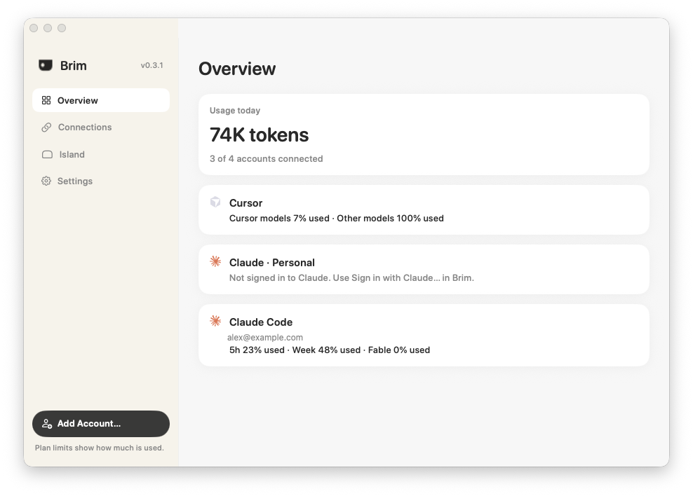
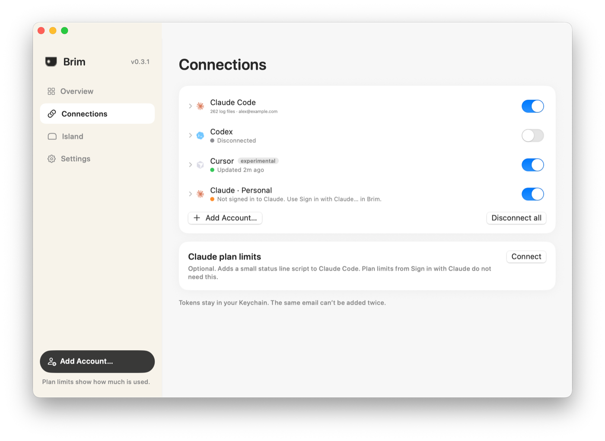
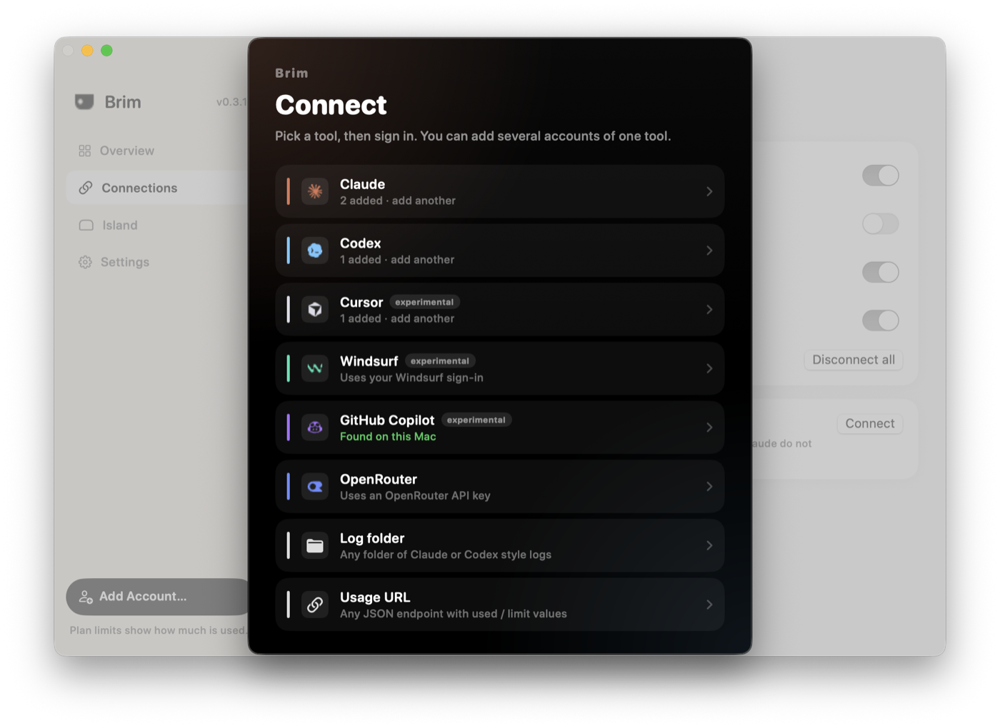

# Brim

**See your AI coding usage at a glance, right in your Mac's notch.**

Brim is a small, free, open-source Mac app. It lives around the notch at the top of your
screen and shows how much you've used your AI coding tools today, and how close you are to each
plan's limits. Hover over it for the details.

Brim used to be called AI Island. Updating moves your connections, saved tokens, settings and
the Claude Code status line over on first launch, and the old `ai-island` command still works.

- **Works with the tools you use.** Claude Code, Codex, GitHub Copilot, Cursor, Windsurf,
  OpenRouter, and anything else that writes logs or reports usage at a URL.
- **As many as you like.** Connect one tool or twenty, including several accounts of the same
  tool (say, personal and work).
- **Private.** No account, no tracking. Your prompts and code are never read.

## About the app

<p align="center">
  
</p>
<p align="center"><em>Overview — today's usage and your connected tools.</em></p>

<p align="center">
  
</p>
<p align="center"><em>The island in the notch — a glanceable usage % while you work.</em></p>

<p align="center">
  
</p>
<p align="center"><em>Connections — turn accounts on or off. (Demo email shown.)</em></p>

<p align="center">
  
</p>
<p align="center"><em>Add Account — pick a tool and sign in. No Terminal needed.</em></p>

---

## Contents

- [Requirements](#requirements) · [Mac requirements](docs/mac-requirements.md)
- [Install](#install) · [Quick setup (CLI)](docs/quick-setup-cli.md)
- [Updating](#updating) · [How to update](docs/how-to-update-brim.md)
- [Connect your first tool](#connect-your-first-tool)
- [Using the island](#using-the-island)
- [Supported tools](#supported-tools)
- [Plans and limits](#plans-and-limits)
- [Command reference](#command-reference)
- [Privacy](#privacy)
- [Troubleshooting](#troubleshooting)
- [Uninstall](#uninstall)
- [Contributing](#contributing)

## Requirements

- A Mac on **macOS 13 Ventura or later** (Apple silicon or Intel).
- **You do not need Xcode** (the big App Store app) for normal use.

A MacBook with a notch looks best, but any Mac works. Without a notch, the island hangs from the
top centre of the screen.

What each install path needs: [docs/mac-requirements.md](docs/mac-requirements.md).

## Install

### Easiest — Download the Mac application

**No Xcode. No Terminal. No developer tools.**

1. Open the latest release: **[Download Brim (GitHub Releases)](https://github.com/abhargava14/brim/releases/latest)**
2. Download **`Brim.dmg`**
3. Open the DMG and drag **Brim** into **Applications**.
4. Open Brim from Applications (see below if macOS shows a warning).

You'll know it's running when you see the Brim mark in the menu bar and a black shape around the notch.

#### If Mac says Brim can’t be opened

macOS may show **“Brim Not Opened — Apple could not verify…”** (or similar). That’s **normal** until
the app is Apple-notarized — **not malware**. Double‑click alone fails on recent macOS.

**Workaround (once is enough):**

1. In **Finder**, open **Applications**.
2. **Right‑click** (or **Control‑click**) **Brim** → **Open**.
3. In the dialog, click **Open** again.

**Alternative:** **System Settings → Privacy & Security** → scroll to the message that Brim was
blocked → **Open Anyway**.

Do **not** turn Gatekeeper off system‑wide. Friend-facing steps:
[docs/gatekeeper-friend-install.md](docs/gatekeeper-friend-install.md). Permanent fix (Developer ID +
notarize): [docs/notarization.md](docs/notarization.md).

### Later updates (still no Xcode)

- In the app: menu bar ✳ → **Check for Updates…**
- Or, if you use Terminal: `brim update`

### For developers / Terminal (optional)

These paths **compile Brim on your Mac**. They need Apple's small **Command Line Tools** package
(`xcode-select --install`) — **not** the full Xcode app from the App Store.

`install.sh` today **builds from source** (it does not download a prebuilt DMG). Details:
[docs/quick-setup-cli.md](docs/quick-setup-cli.md).

**Pinned install script** (pins a release; about a minute the first time):

```bash
curl -fsSL https://raw.githubusercontent.com/abhargava14/brim/v0.3.2/install.sh -o install-brim.sh
chmod +x install-brim.sh
./install-brim.sh
```

**From a clone:**

```bash
git clone https://github.com/abhargava14/brim.git
cd brim
git checkout v0.3.2
./scripts/build-app.sh --install
```

**Homebrew** (tracks `main`, also builds from source):

```bash
brew install --HEAD abhargava14/tap/brim
```

**Build a DMG yourself** (also needs Command Line Tools): see `./scripts/build-dmg.sh` and
[docs/notarization.md](docs/notarization.md).

## Updating

Quit alone does **not** fetch new builds. Prefer:

1. Menu bar ✳ → **Check for Updates…** (no Xcode), or
2. `brim update` (`--check` only reports), or
3. Reinstall from a newer **Brim.dmg**, or rebuild via Terminal.

More detail: [docs/how-to-update-brim.md](docs/how-to-update-brim.md).

## Connect your first tool

On first launch, Brim adds **Claude Code** and **Codex**. If you use either, you'll see your
usage within a few seconds. To add more, use whichever way you prefer. Both change the same
list, so you can mix them.

### In the app

1. Click the ✳ icon in the menu bar and choose **Connections & Settings**. (Or hover over the
   island and click ⚙.)
2. Click **Add connection** and pick a tool.
3. If the tool needs a token, paste it into the box that appears and click **Save**.
4. Use the switch next to each connection to turn it on or off. **Disconnect all** turns
   everything off.

### In the terminal

```bash
brim add claude          # Claude Code
brim add codex           # Codex CLI
brim add copilot         # GitHub Copilot
brim add cursor          # Cursor
brim add openrouter      # OpenRouter (asks for your API key)

brim status              # see your usage
```

Each `add` checks the connection straight away and tells you whether it worked, and what to do if
it didn't.

**Two accounts of the same tool?** Add it twice and give each a name:

```bash
brim add claude --name "Claude · Work" --path ~/work/.claude/projects
```

## Using the island

| You do | What happens |
|---|---|
| Glance at the notch | Two tools, each with its key number (plan % or tokens today) |
| Connect three or more tools | The island takes turns showing them, two at a time. Anything close to a limit, or working right now, always comes first |
| Hover over the island | It opens to show every connection: tokens, plan limits with reset times, and a 14-day chart |
| Move the pointer away | It closes again |
| Click ✳ in the menu bar | A quick summary, Refresh, Disconnect All, and Settings |

**It also tells you when something happens.** For a few seconds, the island grows to show:

- **Connected:** a new tool is working (with a little confetti).
- **Near a limit:** a plan passed 80% or 95%.
- **Limit reached:** a plan hit 100%, and when it resets.
- **Milestones:** 1M, 5M, 10M … tokens in a day.

A tool's icon also moves while that tool is working: Claude's sparkle turns and Codex's brackets
blink. You can turn the animations off in **Settings → Island → Playful animations**. With
**Reduce Motion** turned on in macOS, everything just fades.

The island never takes keyboard focus, lets clicks through to the menu bar around it, and hides
when an app is full screen.

## Supported tools

| Tool | What you need | What you'll see |
|---|---|---|
| **Claude Code** | Nothing. Brim reads its local logs. | Tokens, sessions, 5-hour and weekly limits* |
| **Codex CLI** | Nothing. Brim reads its local logs. | Tokens, sessions, 5-hour and weekly limits |
| **GitHub Copilot** ⚠︎ | The [GitHub CLI](https://cli.github.com) signed in (`gh auth login`), or a GitHub token | Your plan and premium requests used, e.g. 212 / 300 |
| **Cursor** ⚠︎ | The Cursor app signed in on this Mac | Your plan and included usage % |
| **Windsurf** ⚠︎ | The Windsurf app signed in on this Mac | Your plan and credits used % |
| **OpenRouter** | An [API key](https://openrouter.ai/keys) | Credits used against the key's limit |
| **Log folder** | A folder of Claude Code- or Codex-style `.jsonl` logs | Tokens and sessions |
| **Usage URL** | Any web address that returns your usage as JSON | Your usage as a % of your limit |

\* Claude Code only shares plan limits with one extra step. Run `brim claude-limits connect`,
or use **Settings → Plan usage → Connect**. It adds a tiny status-line script to Claude Code and
keeps any status line you already have.

⚠︎ **Experimental.** Copilot, Cursor and Windsurf don't offer a public way to read usage, so
Brim uses the same private connection their own apps use. If one of them changes it, that
connection shows a message and everything else keeps working.

<details>
<summary><b>Connecting a Usage URL (for any other tool)</b></summary>

If a service shows your usage at a URL that returns JSON, Brim can read it. Tell it where the
numbers are with "dot paths":

```json
{ "data": { "used": 420, "limit": 1000, "plan": "Team" } }
```

```bash
brim add custom --name "Acme AI" \
  --url https://api.acme.dev/v1/usage \
  --used data.used --limit data.limit --plan-path data.plan \
  --token-stdin                     # then paste the token and press Enter
```

The token is sent as `Authorization: Bearer <token>` by default. Change it with
`--header` and `--prefix`.
</details>

## Plans and limits

Every connection has a plan, such as Claude **Max 5×**, Copilot **Pro+** or Cursor **Ultra**.
Choose it in Settings or with `brim plan <name> <plan>`, or leave it on **Automatic**.

The plan decides what the island shows first:

- **Subscriptions and monthly allowances** (Claude Pro/Max, ChatGPT Plus/Pro, Copilot, Cursor,
  Windsurf): how much of the limit you've used, as a %.
- **Pay-as-you-go API keys:** tokens used today.

Limits and percentages always come from the tool itself. Brim never guesses them.

## Command reference

| Command | What it does |
|---|---|
| `brim status` | Usage for everything connected. Add `--json` for scripts. |
| `brim list` | Every connection, and whether it's on or off |
| `brim kinds` | Tools you can add, and their plan names |
| `brim add <tool> [options]` | Add and connect a tool |
| `brim connect <name>` / `--all` | Turn a connection back on, or all of them |
| `brim disconnect <name>` / `--all` | Turn a connection off (keeps its settings) |
| `brim remove <name>` | Delete a connection and its saved token |
| `brim set <name> [options]` | Change a connection's name, folder, URL… |
| `brim plan <name> <plan>` | Set a connection's plan (`auto` to go back) |
| `brim claude-limits connect` | Share Claude Code's 5-hour and weekly limits |
| `brim open` | Open the app |
| `brim update` | Check GitHub Releases and install if newer (`--check` to only report) |
| `brim help` | All options, with examples |

Common options: `--name`, `--plan`, `--path` (log folder), `--token-stdin` (paste a token
safely).

## Privacy

- **No account, no analytics, no tracking.**
- **Your prompts, replies and code are never read.** For Claude Code and Codex, Brim reads
  only usage numbers from their logs: tokens, model, time, session and project folder name.
- **Tokens are stored in your Mac's Keychain**, never in plain files. When Claude's OAuth
  access token is refreshed, Brim updates Claude Code's own Keychain item (same service name)
  in-process so the secret never appears on process argv.
- **Cursor / Windsurf:** connecting without a pasted token reuses that editor's local session
  from `state.vscdb` (allowlisted keys only), then copies it into Brim's Keychain so the DB
  is not re-read every refresh.
- **Network:** log-based tools never touch the network. Built-in account tools only call an
  allowlisted HTTPS host for that tool. **Check for Updates** / `brim update` only contact
  `api.github.com` / `github.com` for `abhargava14/brim` Releases (and download the release
  asset). Custom Usage URLs must be `https://` (no cleartext `http://`). Brim trusts macOS
  system roots (no certificate pinning — see security notes in the engineering review
  deliverable).
- Your connection list lives in `~/Library/Application Support/Brim/connections.json`
  (mode `600`). It holds no secrets.
- Custom log folders must resolve under your home directory; symlink escapes are refused.

## Troubleshooting

**macOS says the app "can't be opened" / “Apple could not verify…”.** Normal until notarization —
not malware. See [If Mac says Brim can’t be opened](#if-mac-says-brim-cant-be-opened) (right‑click →
**Open**, or Privacy & Security → **Open Anyway**). Do not disable Gatekeeper system‑wide.

**A tool says "No logs found yet".** Use that tool once, then wait a few seconds. If it keeps its
logs somewhere unusual, set the folder: Settings → open the connection → **Choose…**, or
`brim set <name> --path /path/to/logs`.

**Copilot says GitHub didn't accept the token.** Run `gh auth login` again, or paste a new token
in Settings.

**Cursor or Windsurf won't connect.** Open that app and make sure you're signed in, then click
**Check now**. These connections are experimental and may stop working when those apps update.

**Claude's 5-hour and weekly limits don't show.** Run `brim claude-limits connect`. The
numbers appear after Claude Code's next reply. They're only available on Claude subscriptions,
not API keys.

**`brim: command not found`.** Open Settings → **Terminal → Install**, or add
`~/.local/bin` to your PATH:
`echo 'export PATH="$HOME/.local/bin:$PATH"' >> ~/.zshrc`, then open a new terminal.

**macOS asks whether Brim can use a Keychain item.** That happens once if you saved a token
from the terminal. Choose **Always Allow**.

## Uninstall

```bash
brim claude-limits disconnect           # if you connected Claude's limits
osascript -e 'quit app "Brim"'
rm -rf "/Applications/Brim.app"
rm -f /usr/local/bin/brim ~/.local/bin/brim
rm -rf ~/Library/Application\ Support/BrimApp ~/.brim
```

Saved tokens are in **Keychain Access** under `com.brim.app.connections`. Delete them there
if you like.

## Contributing

Bug reports and pull requests are welcome. Adding a tool is the most useful contribution.

```bash
swift test                    # run the tests (needs Xcode)
swift run BrimApp            # run the app from source
swift run brim status    # run the command from source
```

How the code is organised:

| Folder | What's in it |
|---|---|
| `Sources/IslandCore` | Log parsing, usage totals, connections, plans. Plain Swift, fully tested. |
| `Sources/IslandServices` | Talking to Copilot, Cursor, Windsurf and OpenRouter; Keychain |
| `Sources/BrimApp` | The Mac app: the island, menu bar and Settings |
| `Sources/BrimCLI` | The `brim` command |

**To add a tool:** add it to `ToolKind` and `Plans`, write a parser for its logs or its usage
response (with a test using a sample response), and give it an icon and colour in
`IslandView.swift`. Until it's built in, a **Log folder** or **Usage URL** connection usually works.

## License

[MIT](LICENSE). Free to use, change and share.
